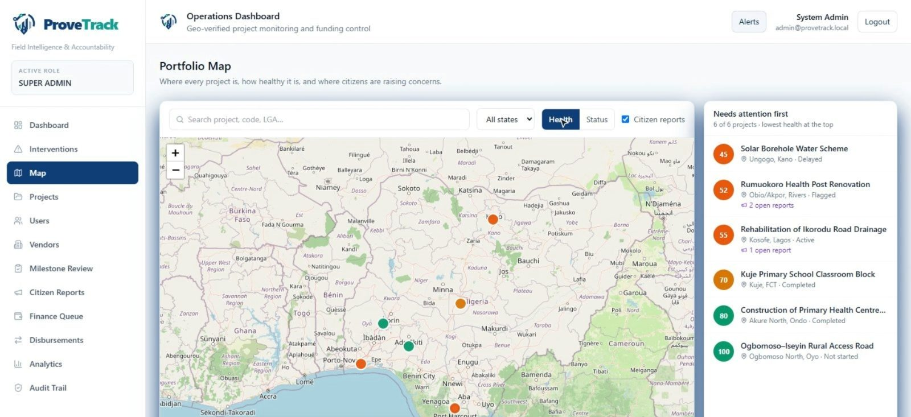
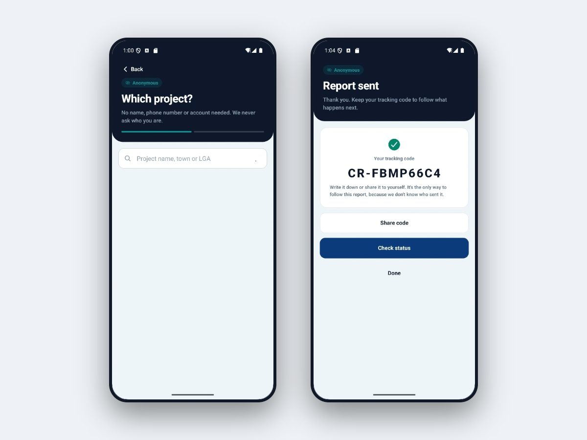
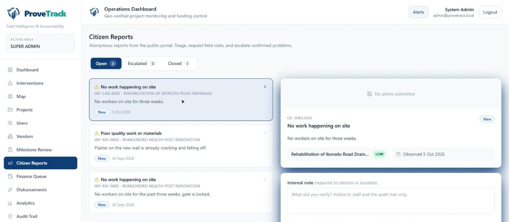
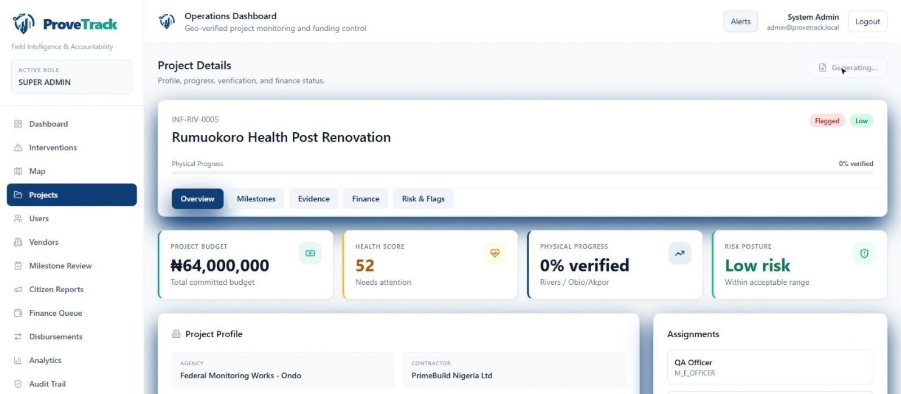
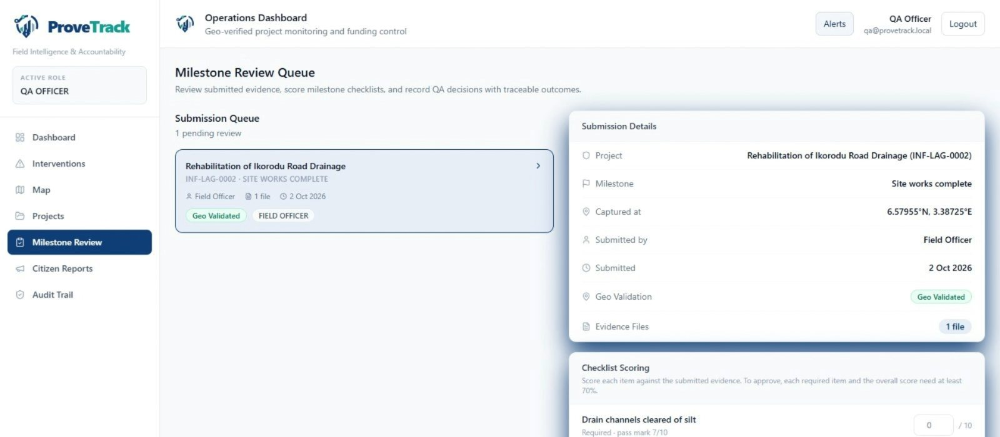
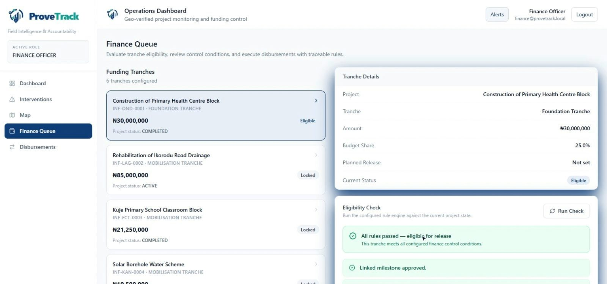

# ProveTrack

**Field Intelligence & Accountability Platform**

*Track Progress. Prove Delivery.*

[](https://github.com/niyioo/provetrack/actions/workflows/ci.yml)

ProveTrack is a field intelligence and accountability platform that helps organisations track projects, verify on-site progress, capture evidence and turn citizen reports into actionable outcomes. Every payment is tied to geo-verified progress.

> **No verified milestone → No QA approval → No disbursement**

---

## What It Does

ProveTrack replaces contractor self-reporting with a rules-driven digital workflow. Funds stay locked until field evidence is captured, geo-verified, and QA-approved.

Built for ministries, donor-funded programs, public works teams, and institutional oversight units.

---

## Key Features

- **Project Registry** — Register projects, contractors, budgets, timelines, and milestones
- **Milestone Engine** — Sequenced milestones with evidence requirements and dependency rules
- **Field Evidence Capture** — Live in-app capture with GPS, geo-fence validation, and offline queuing
- **QA Review** — Approve, reject, or flag evidence with full audit history
- **Funding Gate Logic** — Deterministic tranche unlock based on milestone, evidence, and QA state
- **Analytics** — Physical vs financial progress, burn variance, delay detection, risk scoring
- **Citizen Reporting** — Anonymous reports from the Android app or web portal, with a private tracking code; staff triage, reply or escalate to block payment
- **Portfolio Map & Reports** — Every project on one map coloured by health against plan; one-click PDF reports with a SHA-256 fingerprint, and CSV export

---

## System Preview

▶️ **Watch the walkthrough:** [ProveTrack: How It Works](https://youtu.be/UoBgRy5QGOw) · Case study: [bravedgesolutions.com/provetrack](https://www.bravedgesolutions.com/provetrack)

### Portfolio map
Every project on one map, coloured by health measured against its own plan, with the riskiest listed first.


### Anonymous citizen reporting
No name, phone number or account needed; the citizen gets a tracking code to follow what happens next.


### Citizen report triage
Reports land in the staff queue, where staff request a field visit, reply to the citizen, or escalate to a fraud flag that blocks payment.


### Project details
Budget, health score, verified physical progress and risk at a glance, with a one-click fingerprinted report.


### QA review
Geo-verified evidence is scored against a checklist; every required item must reach the milestone's pass mark.


### Funding release check
A tranche is released only when every rule passes: approved milestone, verified evidence, independent validation and no open fraud flags.


---

## Tech Stack

| Layer | Stack |
|---|---|
| Backend | Django, DRF, PostgreSQL/PostGIS, Celery, Redis |
| Frontend | React, Vite, TypeScript, TanStack Query, Tailwind CSS |
| Mobile | Expo, React Native, TypeScript |

---

## Quick Start

### Backend
```bash
cd backend
python -m venv .venv && source .venv/bin/activate  # or .venv\Scripts\activate on Windows
pip install -r requirements.txt
# Configure backend/.env (see README details)
python manage.py migrate
python manage.py seed_provetrack
python manage.py runserver 0.0.0.0:8000
```

### Frontend
```bash
cd frontend
npm install
# Configure frontend/.env with VITE_API_BASE_URL
npm run dev
```

### Local Infra
```bash
docker compose up -d db redis
```

### Background Jobs
```bash
cd backend
.venv\Scripts\python.exe -m celery -A config worker -l info
.venv\Scripts\python.exe -m celery -A config beat -l info
```

### Windows One-Command Startup
```powershell
.\scripts\start-local-stack.ps1
```
This launches:
- Django API
- Celery worker
- Celery beat
- Frontend Vite dev server

### Mobile
```bash
cd mobile
npm install
# Configure mobile/.env with EXPO_PUBLIC_API_BASE_URL (use LAN IP for physical devices)
npx expo start -c
```

### Citizen Portal
A separate public site where anyone can anonymously report on an ongoing project.
It talks only to the unauthenticated `/api/public/` endpoints and shares no code with the staff dashboard.
```bash
cd citizen-portal
npm install
# Configure citizen-portal/.env with VITE_PUBLIC_API_BASE_URL (see .env.example)
npm run dev   # http://localhost:5174
```
Reports land in the staff dashboard under **Citizen Reports** for triage. When enough *distinct*
anonymous reporters raise concerns about a project, its risk is raised automatically (never a
payment block). Only a staff escalation creates a fraud flag, which blocks tranche release.
Set `NUM_PROXIES` correctly in production, or every citizen will appear to share one IP.

---

## Default Seed Credentials

| Role | Email |
|---|---|
| Admin | `admin@provetrack.local` |
| Field Officer | `field@provetrack.local` |
| QA Reviewer | `qa@provetrack.local` |
| Finance | `finance@provetrack.local` |

**Password:** `Password123!`

---

## Project Structure

```
provetrack/
├── backend/    # Django API
├── frontend/        # React web dashboard (staff)
├── citizen-portal/  # Public anonymous citizen reporting site
└── mobile/          # Expo field app
```

---

## Testing

CI (`.github/workflows/ci.yml`) runs on every pull request: backend tests against PostGIS,
a migrations-vs-models check, type-checks for `frontend/`, `mobile/` and `citizen-portal/`,
and a production build of the citizen portal image.

To run the backend tests locally, the suite expects a provisioned PostGIS test database
(`tests/conftest.py` reuses it rather than creating one):

```bash
docker compose up -d db
docker compose exec db psql -U infra -d infratrack -c "CREATE DATABASE infratrack_test;"
docker compose exec db psql -U infra -d infratrack_test -c "CREATE EXTENSION postgis;"
```

Then run `pytest` with `DJANGO_SETTINGS_MODULE=config.settings.test` and `DB_HOST` pointing at that database.

---

## Deployment

**Follow [docs/DEPLOYMENT.md](docs/DEPLOYMENT.md).** It takes a fresh server to a
running pilot with one Compose file ([`deploy/docker-compose.prod.yml`](deploy/docker-compose.prod.yml)):
automatic HTTPS via Caddy for the dashboard, API and citizen portal, backups,
the reporter-anonymity checklist, and building the Android app.

Production settings (`config.settings.prod`) refuse to start without `SECRET_KEY`,
`ALLOWED_HOSTS`, `CORS_ALLOWED_ORIGINS`/`CSRF_TRUSTED_ORIGINS` (both the dashboard
and portal origins) and `NUM_PROXIES`. The runbook explains each one.

---

## Notes

- Requires **GeoDjango + PostGIS**. On Windows, install GDAL/GEOS/PROJ via OSGeo4W and set paths in `.env`.
- Scheduled analytics refresh depends on **Redis + Celery worker + Celery beat** being up.
- The analytics cache can be manually refreshed with `python manage.py refresh_analytics_snapshots`.
- For mobile on a physical device, use your machine's **LAN IP**, not `127.0.0.1`.
- Never commit real secrets or production credentials.

---

**Author:** Adeniyi Olateru-Olagbegi — BravEdge Solutions
